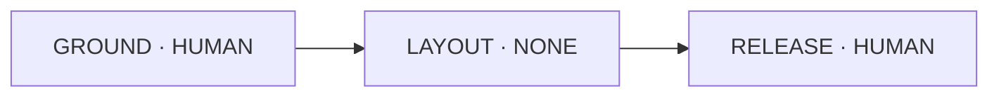

# Architecture overview

The full variant is an instruction-only product architecture. Owner skills define
workflow and engineering responsibilities. Five profiles adapt role contracts
to native host formats. `cad-record` provides record layout and schemas. Runtime
CAD programs and semantic-check programs are written in the product project,
not shipped here. The ordinary host lead invokes `cad-flow`; it is not a sixth
agent.

## Owner skills

| Skill | Canonical responsibility |
| --- | --- |
| [`cad-flow`](../full/skills/cad-flow/) | Stage sequence, gates, approvals, lead workflow, dispatch, delivery and change impact. |
| [`cad-record`](../full/skills/cad-record/) | Record layout, IDs, schemas, templates, fixture contracts, imports and semantic-check procedure. |
| [`cad-select`](../full/skills/cad-select/) | Use case, sourcing, material/process/architecture selection, feasibility and transparency. |
| [`cad-design`](../full/skills/cad-design/) | Requirements and interfaces, concepts, variants, assembly layout and manufacturable part intent. |
| [`cad-model`](../full/skills/cad-model/) | Runtime CAD model contract, kernels, units, frames, deterministic inputs, exports and readback. |
| [`cad-verify`](../full/skills/cad-verify/) | Expected obligations, methods, results, facets, evidence, uncertainty and physical-validation rules. |
| [`cad-review`](../full/skills/cad-review/) | Independent mechanical and design-for-manufacture review and the severity rubric. |
| [`cad-release`](../full/skills/cad-release/) | Reviewed drawings, derived BOM, frozen package, release claims and ceiling. |

Each domain rule has one owner. Other skills and agents link to that owner.

## Roles and host profiles

[`full/skills/cad-flow/references/agent-roles.md`](../full/skills/cad-flow/references/agent-roles.md)
owns the five role contracts:

| Role | Bounded work |
| --- | --- |
| `cad-concept-designer` | Produce an assigned concept variant and coarse architecture. |
| `cad-part-designer` | Design assigned part records, models and manufacturing intent. |
| `cad-checker` | Independently run assigned checks and publish scoped results. |
| `cad-mech-dfm-reviewer` | Review frozen evidence read-only; write nothing and do no design work. |
| `cad-sourcing-researcher` | Research and cite material, process and procurement options. |

Each role has profiles for Claude Code, Codex CLI, OpenCode, Kiro CLI V3 and OMP
under `full/harness/` and `lean/harness/`. Profile syntax adapts the role
contract to host formats.
Host permission behavior is not an OS confinement boundary.

## Thirteen-stage flow

The machine-readable policy lives in
[`cad-flow/assets/stages.yaml`](../full/skills/cad-flow/assets/stages.yaml).
[`cad-flow/references/stages.md`](../full/skills/cad-flow/references/stages.md)
owns execution guidance. `NONE` advances without human approval, `HUMAN` needs
explicit approval, and `REVIEW` needs the independent review result.

A verdict does not grant approval. A HUMAN stage waits for a decision over its
named packet. A failure or change reopens its causal stage and dependents. A
full build runs all 13 stages; a lite build runs three of them.

## Lite build

The build mode selects the stage policy. `cad-select` asks `Q-000`, full or lite,
in the first intake batch and recommends lite for initial prototyping
([choose the build mode](../full/skills/cad-select/references/selection.md#choose-the-build-mode)).
The answer becomes the sourced fact `product.build_mode`. Each attempt reads the
mode from its frozen snapshot, never from a session setting. An unanswered mode
blocks GROUND. A record without the fact is a historical full record.

The lite policy is the lite stage list in
[`cad-flow/assets/stages.yaml`](../full/skills/cad-flow/assets/stages.yaml):

- GROUND writes the sourced geometry requirements and their check plan, freezes
  them and has them checked independently. The owner approves this brief before
  any geometry exists. The lite intake never asks about material, process,
  printer, vendor, load or capability
  ([lite intake](../full/skills/cad-select/references/selection.md#lite-intake)).
- LAYOUT models the requested finished prototype form, not an envelope, and
  builds the part and assembly STEP, GLB and SVG. An independent checker
  rebuilds, reads back, exports, identifies features, renders and compares the
  model with the frozen intent. Its `geometry.readback` also imports every
  STEP in the installed FreeCAD console through a helper the checker writes in
  the product project. A complete technical PASS advances without an owner
  gate. Without FreeCAD the readback is UNKNOWN `NOT_RUN` and LAYOUT is BLOCKED.
- RELEASE publishes a small CAD_VALID verification index, the build guide and the
  release proposal before its checks, then waits for the owner's approval of that
  exact package and seals it last
  ([lite release](../full/skills/cad-release/references/release.md#lite-release)).
  Every packet and the guide carry the line `LITE prototype: geometry only; no
  material, fit, strength or manufacturing claims`.

Skipped stages get no verdict, decision or result. Normally only
`cad-part-designer` and `cad-checker` units run. The lite build adds no skill,
role, stage ID, check family or plugin. Both record variants carry its shapes;
lean keeps them in its existing roots and prose tables.

Promotion to full is an approved CHANGE that reopens GROUND
([change impact](../full/skills/cad-flow/references/change-impact.md)). Every
lite version, result and package stays immutable. The full build then runs all
13 stages and their gates. Lite geometry carries over only as concept input,
never as full evidence.

## Record and hash contract

[`cad-record`](../full/skills/cad-record/) owns
[`layout.json`](../full/skills/cad-record/layout.json), field schemas and record
procedures. Product records use `format: cad-agent-skills`,
`record_version: 1`, project-relative paths, stable IDs, explicit units/frames,
source-backed facts, and distinct controlled, immutable, derived and scratch
data. This is a new contract, not cad-agent v1. Schema validation checks file
shape. Cross-file semantics remain a model-written program in the product
project, independently inspected.

The hash graph is acyclic. Its order is:

1. Digest working inputs.
2. Create a version manifest of record snapshot, source, locks and geometry.
3. Bind results to a worker unit or version manifest.
4. Inventory results, sources, artifacts and logs in bundle manifests.
5. Write the stage verdict from accepted bundles.
6. Bind gate decisions to verdicts.
7. Build the release inventory from approved inputs before the final manifest.

Each object excludes its own digest and downstream result bytes. See
[`cad-record/references/record.md`](../full/skills/cad-record/references/record.md#acyclic-hash-graph)
for exact bindings and inventory rules.

## Full and lean variants

Full carries eight skills, five roles and all 28 record roots, plus fixtures,
assets and harness files.
Lean uses the same skills, roles and procedures with 11 direct record roots:
`common`, `product`, `requirements`, `part`, `assembly`, `decision`,
`check-result`, `stage-verdict`, `material-profile`, `bom-row` and
`release-manifest`. The other 17 contracts are prose tables in
[`lean/skills/cad-record/references/prose-contract.md`](../lean/skills/cad-record/references/prose-contract.md).
Model-written `record.semantic` item 17 checks those tables.
Applicable embedded item shapes retain schemas.

The variants share 13 stage IDs, gate kinds, 30 procedure IDs and
54 check-family names. Only the record schema set differs. Shared lean roots
are byte-identical to full, so each shared-root lean record is full-valid. CI
checks lean layout, material-profile wrappers, capabilities and flow policy
against full schemas. Regression cases use full schemas because lean omits some
roots. Install one variant per project because names match. Both variants ship
in this repository. Parallel content is not an A/B result. The
[A/B protocol](demo.md#ab-protocol-full-versus-lean) treats full as baseline,
controls inputs and defaults a tie to full.

The build mode is independent of the variant: full and lean each run full and
lite builds with the same lite stages, checks and package. "Lite" names the
build and "lean" the record contract, so neither implies the other.
